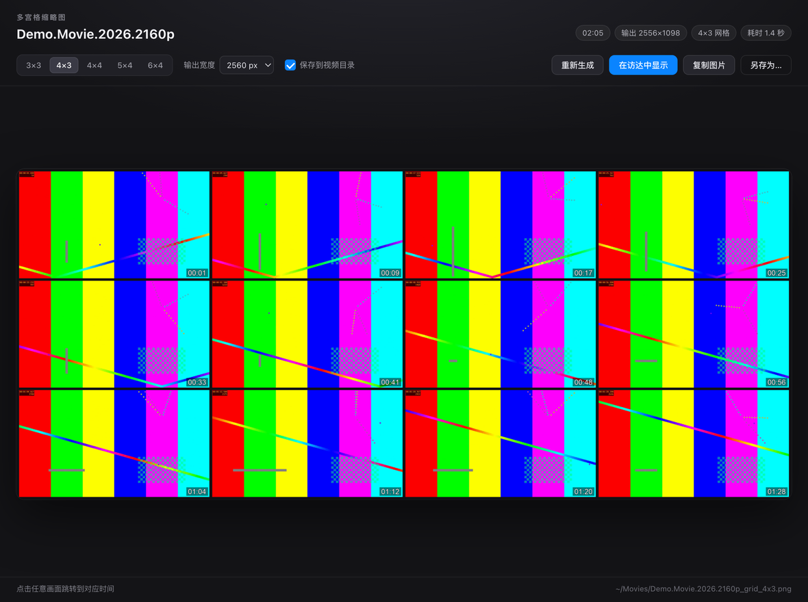

# GridSheet · IINA 多宫格缩略图插件

**An IINA plugin for macOS that generates multi-grid thumbnail contact sheets from the current video.**
一个运行在 [IINA](https://iina.io) 里的多宫格缩略图（contact sheet）插件：不用离开播放器，就能把视频导出成带时间码的宫格图。



> 这是 IINA 插件，不是独立播放器。安装后出现在 IINA 的 **插件** 菜单里。

## 功能

- **5 种网格**：3×3、4×3、4×4、5×4、6×4，窗口内随时切换并重新生成
- **时间码**：跳过片头片尾各 2%，均匀抽帧，每格烧录 `HH:MM:SS`
- **HDR tonemap**：自动识别 PQ / HLG（`smpte2084` / `arib-std-b67`），先 tonemap 再拼图
- **点击跳转**：在预览窗口点任意一格，播放器跳到对应时间
- **中文界面**：独立预览窗口，支持复制图片、在访达中显示、另存为
- **默认存到视频目录**：缩略图和视频放在一起，方便一眼认出文件内容；窗口内可切换回图片目录
- **输出宽度可调**：1920 / 2560 / 3840 / 5120 px，默认 2560 px，预览窗口里随时切换重新生成
- **一条龙**：生成后自动保存为 PNG，并显示保存路径

## 环境要求

- macOS
- IINA **1.4+**（在 1.5.0 上实测）
- `ffmpeg` 与 `ffprobe`

```sh
brew install ffmpeg
```

插件会自动在 `/opt/homebrew/bin`、`/usr/local/bin`、`~/.local/bin`、`~/bin`、`/usr/bin` 和插件自己的 `@data/bin` 里查找，不需要手动配置路径。

## 安装

### 从 Release 安装（推荐）

1. 下载 [最新 Release](https://github.com/jay5512831/iina-gridsheet/releases) 里的 `GridSheet-*.iinaplgz`
2. 双击文件，按 IINA 提示安装
3. 打开 **IINA → 设置 → 插件**，确认「多宫格缩略图」已启用，然后重启 IINA

### 从 GitHub 安装

在 IINA 的插件设置里选择从 GitHub 安装，填入：

```text
jay5512831/iina-gridsheet
```

### 安装不成功？

1. **先确认入口位置**：插件不是独立 App，安装后出现在 IINA 菜单栏的 **插件** 菜单里；没有打开视频时，v1.2+ 也会显示「多宫格缩略图：选择视频并生成…」。
2. 如果双击 `.iinaplgz` 没反应，打开 **IINA → 设置 → 插件 → 安装本地插件…**，选择下载的 `.iinaplgz`。
3. 安装后需要**重启 IINA**；如果列表里有但菜单里没有，确认插件开关是打开的。

### 从源码加载（开发）

```sh
git clone https://github.com/jay5512831/iina-gridsheet.git
/Applications/IINA.app/Contents/MacOS/iina-plugin link "$PWD/iina-gridsheet"
```

## 使用

1. 用 IINA 打开一个本地视频；还没打开视频时，可以先用 **插件 → 多宫格缩略图：选择视频并生成…**
2. 菜单 **插件 → 为当前视频生成多宫格缩略图**，或按 `⌘⇧G`
3. 也可以选 **插件 → 选择视频文件生成多宫格缩略图…**，不播放也能生成
4. 预览窗口里：
   - 点画面：跳到对应时间
   - 顶部切换网格 / 输出宽度：立即重新生成
   - `在访达中显示` / `复制图片` / `另存为…`
   - `Esc` 关闭窗口，`⌘S` 另存为

生成的文件默认保存在**视频所在文件夹**：

```text
<视频所在文件夹>/<视频名>_grid_<列>x<行>.png
```

预览窗口顶部的「保存到视频目录」开关可以随时切换；关闭后保存到：

```text
~/Pictures/多宫格缩略图/<视频名>_grid_<列>x<行>.png
```

如果视频所在目录不可写（只读磁盘、部分网络盘等），会自动回退到图片目录并提示。

## 实现方式

1. `ffprobe` 读取时长、分辨率、旋转、HDR 标记；
2. 计算 `列 × 行` 个均匀时间点（避开片头片尾各 2%）；
3. 每个时间点用 `ffmpeg -ss ... -frames:v 1` 快速抽帧，按原片比例缩放并补边，`drawtext` 烧录时间码；
4. 用 `tile` 滤镜拼成一张 PNG；
5. 优先保存到视频所在目录（不可写则回退到图片目录），再把 PNG 以 base64 传给 IINA 的 `standaloneWindow` 预览；
6. 点击格子时通过 `core.seekTo()` 跳转。

抽帧使用 3 个并发；HDR 片源走 `zscale + tonemap`，如果本机 ffmpeg 不带 zscale 会自动降级重试。

## 开发

```
.
├── Info.json               # IINA 插件清单
├── src/index.js            # 主逻辑
├── src/global.js           # 全局入口（无视频时也能选择文件）
├── ui/window.template.html # 窗口模板
├── ui/window.css
├── ui/window.js
├── ui/window.html          # 构建产物（内联 CSS/JS）
├── build_ui.py             # 生成 window.html
├── tests/mock-run.js       # 无头模拟 IINA API，跑通全流程
├── tests/preview.py        # 生成窗口静态预览
├── scripts/package.sh      # 打 .iinaplgz 安装包
├── scripts/install.sh      # 本地直接安装
└── docs/preview.png
```

```sh
python3 build_ui.py                 # 重新生成 ui/window.html
node tests/mock-run.js              # 抽帧 → 拼图 → 保存 → 消息 全流程测试
./scripts/package.sh                # 输出 dist/GridSheet-<version>.iinaplgz
./scripts/install.sh                # 安装最新 dist 包并重启 IINA
```

调试提示：`standaloneWindow.loadFile()` 会清空通过 `onMessage` 注册的监听器，因此本插件在每次 `loadFile` 之后重新注册监听器（见 `src/index.js` 的 `ensureWindow`）。

## 参考与致谢

本项目的实现代码为原创，**没有复制下列项目的代码**；仅在功能定位和交互上做了参考：

- **[ThumbnailGridStudio](https://github.com/leiweibau/ThumbnailGridStudio)**（leiweibau）——
  参考了「把视频导出为多宫格联系表」的产品思路。本项目通过 ffmpeg + IINA Plugin API 重新实现。
- **PotPlayer** 的「创建缩略图」对话框（Windows）——
  参考了设置项的组织方式（宫格、宽度、边距、保存位置等），用作后续设置面板的交互参考；未使用其代码。
- **[IINA Plugin API 文档](https://docs.iina.io/)** 与 `iina-plugin` 工具链。

## Roadmap

- ~~v1.1：默认保存到视频所在目录；保存位置可配置；无写权限时回退到图片目录~~ ✅
- ~~v1.2：输出宽度可调（1920–5120 px）；无视频时的全局入口~~ ✅
- **v1.3**：边距 / JPEG 质量 / 字体 / 文件信息开关等可选设置
- **v1.4**：批量处理文件夹、侧边栏常驻缩略图

## License

[MIT](LICENSE) © 2026 jay5512831
